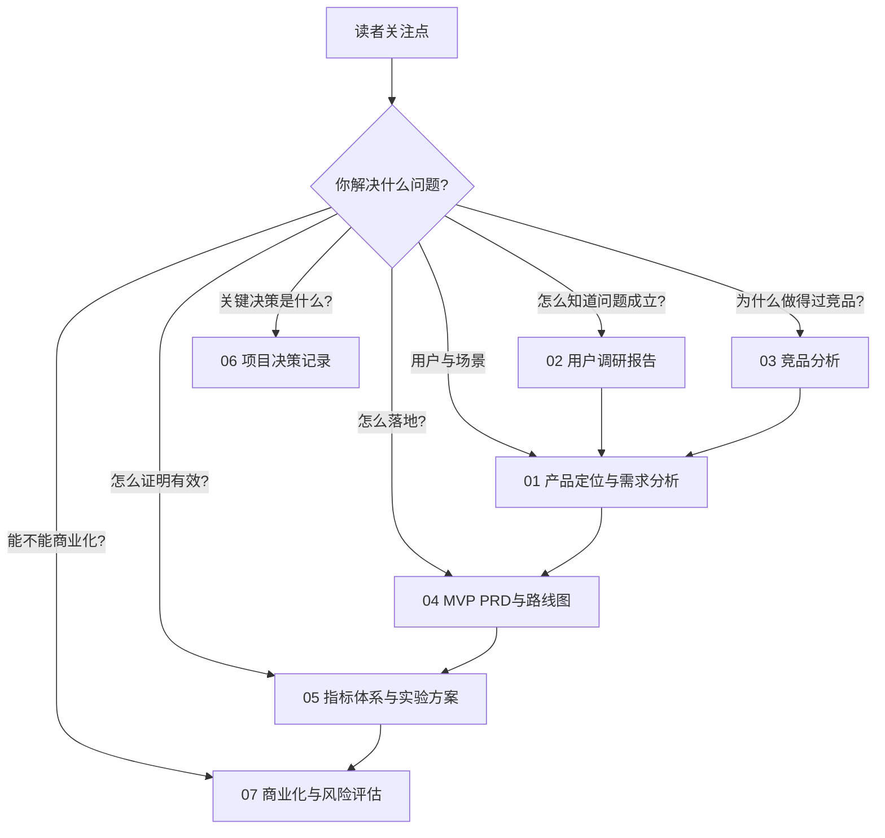

# 事实基线与作品集说明

## 1. 这份作品集要证明什么

这不是把工程代码改写成产品宣传稿，而是展示一名 AI 产品经理如何把一个技术原型转化为可验证的产品方案：

作品集中的每一个结论都应能回答三个问题：事实从哪里来、假设如何验证、如果验证失败如何调整。

## 2. 当前项目已经实现的能力

| 能力 | 项目证据 | 可以转译成的产品能力 | 不能夸大的部分 |
|---|---|---|---|
| 多 Agent 编排 | `src/multi_agent/`、`docs/architecture.md` | 发现、验证、汇总、修复、验证的工作流 | 尚未等同于成熟 PR 产品体验 |
| 工具与执行循环 | `src/harness/`、`src/tools/` | 读取代码、搜索、命令执行、受控写入 | 生产级容器隔离和多租户仍需补齐 |
| 安全控制 | JWT、HITL Guard、sandbox、限流相关实现 | 权限、审批、审计和危险动作控制 | 仍需企业 SSO、密钥托管、合规证明 |
| 评测体系 | `docs/agent-evaluation-plan.md`、`tests/eval/`、`reports/` | 质量、轨迹、故障归因、稳定性和成本度量 | replay 已全量扫描；稳定性泛化与真实客户 ROI 尚未验证 |
| 多入口 | Streamlit、CLI、FastAPI | Web、命令行、API 使用方式 | GitHub/GitLab OAuth、Webhook 属于产品化规划 |
| 反馈与报告基础 | finding、verdict、review report、telemetry | 发现卡片、状态、反馈、趋势面板 | 用户研究和连续使用数据尚未建立 |

## 3. 评测事实与边界

### 3.0 当前权威基线（2026-10-13）

**引用本项目审查能力时，以这一组数字为准**（完整口径见
[评测基线：严格标准下的精确优先](../eval-baseline.md)）：

| 项 | 值 |
|---|---|
| 数据集 | `llm-agent-qa-system-labeled` **v1.2.0**（124 条：84 正例 + 40 负例） |
| 模型 / 配置 | `gpt-6-sol`，温度 0.0，`responses` 协议，高强度思考 |
| Precision / Recall / F1 | **94.0% / 56.0% / 0.70** |
| 混淆矩阵 | TP=47、FP=3、FN=37、TN=37 |
| 判分完整性 | **124/124，零跳过零异常** |

**按严重度分层**（这是比总平均更有用的形态）：

| 严重度 | 正例 | 检出 | 漏报 | 召回率 |
|---|---|---|---|---|
| **High** | 4 | 4 | 0 | **100%** |
| Medium | 19 | 13 | 6 | 68% |
| Low | 61 | 30 | 31 | 49% |

即"**高危不漏、低危漏多**"。37 条漏报中 30 条属"模型认为不该报、而标注标准
认为该报"的判据口径分歧，仅 7 条属"模型该报而没报"。两条提高召回率的提示词
路径（放宽判据、改开放式枚举）均已实验证伪，因此当前策略是**精确优先**。

> ⚠️ **跨标签版本不可比较**：正例分母经 108（v1.0.0）→ 81（v1.1.0）→ 84（v1.2.0）
> 三次变化。下面 3.1 节的历史记录**仅作沿革**，不得与 3.0 的基线相减或取优。

### 3.1 历史评测记录（沿革，不代表当前能力）

标注集版本沿革：v1.0.0（108 正例）→ v1.1.0（逐条复核发现 29 条原标注描述的缺陷
在当前代码里已不存在，其中 2 条重定位、27 条翻为负例）→ v1.2.0（再复核发现
3 条负例仍含其它真实缺陷，改回正例并替换描述）。总数始终保持 124 条。

- 标注集正确目标项目的文件匹配率为 124/124（`preflight()` 可机器校验，含锚点指纹）。
- 2026-09-11 的阶段性链路报告记录曾在 77/124 后暂停；后续同日的 full 报告记录扫描完成 124/124。阶段报告是中途快照，不代表最终结果。
- 2026-09-27 的 replay 产物再次扫描 124/124：TP=41、FP=2、FN=67、TN=14；运行口径 Precision=95.3%、Recall=38.0%、F1=0.54（**v1.0.0 标签下**）。3 条 API 超时在当前评测脚本中被记为 FN。
- 排除上述 3 条 API_ERROR 后，模型成功响应口径为 TP=41、FP=2、FN=64、TN=14：Precision=95.3%、Recall=39.0%、F1=0.55。应同时保留运行口径，不能把 API 失败从端到端可靠性指标里抹掉。
- 2026-09-10 的旧日志基线中有 77/86 个运行未收尾，这是历史采集覆盖缺口，不应归因给模型；后续 2026-09-27 离线报告的 10/10 个运行均有 `session_end`，说明新采集链路样本已收尾，但不能反写或抹去旧日志事实。
- 当前尚未完成真实客户访谈、真实 PR 试点、完整自动修复质量评测和长期 ROI 证明。

对应证据入口：

- [系统架构](../architecture.md)：入口、编排、Harness、工具和数据层。
- [评测实施方案](../agent-evaluation-plan.md)：数据集、指标、失败分类、阶段状态和明确缺口。
- [指标可达性与数据管道](08_指标可达性与数据管道.md)：**哪些指标今天真的有数据**（已落地/半落地/仅规划判定）。
- [评测基线](../eval-baseline.md)：当前唯一权威口径、引用规则与已知局限。
- [评测报告目录](../../reports/)：离线、基线和真实链路产物；阅读时以报告中的样本范围和备注为准。
- [2026-09-27 全量 replay 复盘](../../reports/eval_replay_20260927.md)：完整样本扫描结果、API_ERROR 处理口径与可复现性缺口。
- [测试目录](../../tests/)：功能、遥测、故障注入与评测自测代码。
- [整改清单](../current-remediation-plan.md)：已修 / 未修项及其证据，按代码级、评测闭环、企业级、产品化分类。

## 3.1 工程侧质量门禁现状（2026-10-07 起）

CI 的 `eval-gate` 作业已把"离线故障集无关键回归才发布"从建议变成自动门禁：

- 10 条离线故障注入用例 × repeat 全部通过；
- `src/eval/report.py::TARGETS` 逐项达标，**必需指标无样本即失败**（fail-closed）；
- 与入库基线 `reports/eval_offline_baseline.json` 比对，指标变差 / 失败计数增加 /
  **采集覆盖度下降**都判为回归。

仍未自动化的（见 08 文档）：Precision/Recall/F1 门禁（需真实 API 与版本锁定）、
高危问题人工复核、全部用户价值指标（无产品埋点）。

## 4. 作品集阅读地图

## 5. 项目展示建议使用的表述

推荐说：“我把已有工程能力抽象成一个待验证的产品方案，并明确区分实现事实、行业观察和产品假设。”

不推荐说：“已经有大量客户使用、准确率达到某个固定值、已经支持 GitHub PR 自动审查。”除非后续确实完成对应试点并把证据补入仓库。

## 6. 继续补证的优先顺序

1. 完成 10～14 人访谈并留存匿名研究记录。
2. 用同一脱敏仓库完成竞品实测矩阵。
3. 做只读 PR 原型，观察首结果时延、证据理解和反馈率。
4. 完成完整评测 replay、重复运行稳定性和自动修复质量评测。
5. 用至少 3 个团队的两周试点数据更新商业化判断。
